<div align="center">

# Aurelion

**Retail management for luxury boutiques**

Inventory, point of sale, returns and exchanges, clienteling, promotions and reporting in one Django application.


<br>

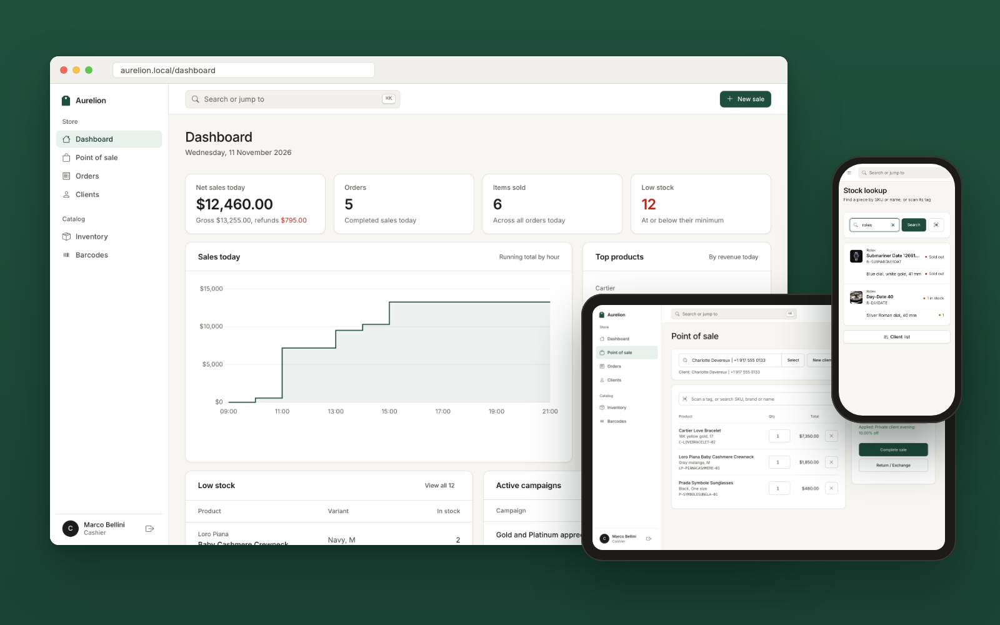

</div>

> [!NOTE]
> **Showcase edition.** Aurelion was built for a single-location luxury boutique. The client's name and
> branding have been changed for confidentiality, and this repository is a reduced version published for
> demonstration. The production system differs from what is shown here.

## Contents

- [Overview](#overview)
- [Features](#features)
- [Screenshots](#screenshots)
- [Tech stack](#tech-stack)
- [Architecture](#architecture)
- [Getting started](#getting-started)
- [Configuration](#configuration)
- [Roles and permissions](#roles-and-permissions)
- [REST API](#rest-api)
- [Security](#security)
- [Testing](#testing)
- [Project structure](#project-structure)
- [License](#license)

## Overview

Luxury retail has different needs from ordinary retail. A single handbag can be worth more than a month of
stock in a regular shop, each piece may carry a serial number and authenticity papers, and the relationship
with the client matters as much as the sale.

Aurelion covers the whole boutique workflow: cataloguing high-value pieces with provenance, selling at the
counter, handling returns and exchanges, rewarding loyal clients, and giving the owner a live view of revenue,
margin and stock. It is designed to work equally well on a touch tablet at the till and on a desktop in the
back office.

## Features

**Point of sale**
- Scan a barcode, or search by SKU, brand or product name and tap a result
- Attach a client, apply promotion codes, and preview discounts calculated on the server
- Prices always come from the catalogue; checkout writes the order, stock and promotion usage in one transaction
- Short order codes (for example `#6HUK3M`) and a printable receipt

**Returns and exchanges**
- Look up an order by its code and return part or all of it within the 10-day window
- Refund, or exchange for other pieces in the same flow; stock is restored automatically
- Every return is linked to its original order, with the reason and the staff member who processed it

**Catalogue and inventory**
- Quick add for everyday items and an eight-section registration form for high-value pieces
- Variants with colour, size, cost and retail price, serial numbers, authentication codes and edition numbers
- Packaging and provenance records, product photos, archive instead of delete
- Low-stock tracking against each variant's own minimum level
- Code 128 label sheets as print-ready A4 PDFs, and camera barcode lookup on the shop floor

**Clients and promotions**
- Client book with contact details, notes, purchase history and Regular, Silver, Gold and Platinum tiers
- Percentage, fixed-amount, buy-X-get-Y and tier-based promotions with schedules and usage limits

**Reporting**
- Today's net sales with a running total by hour, top products by revenue, and stock that needs attention
- Revenue, cost, gross profit and margin over 7, 30 or 90 days, exportable to Excel

**Workspace**
- Role-based access for owners, cashiers and sales associates
- Command palette (`Cmd K` / `Ctrl K`) to jump to any page or search inventory, clients and orders
- Responsive layout with larger touch targets on tablets and phones

## Screenshots

### Point of sale and stock lookup

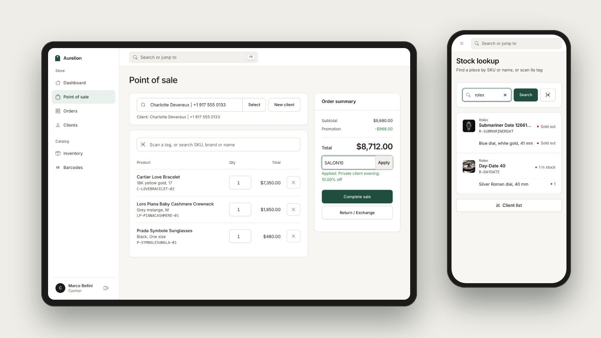

### Dashboard

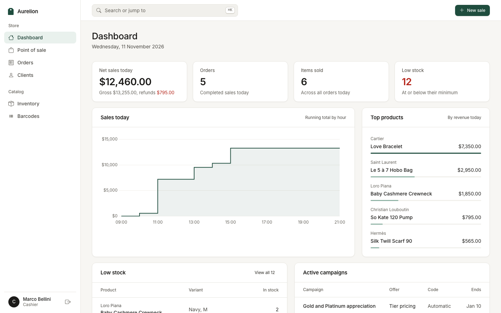

### Inventory

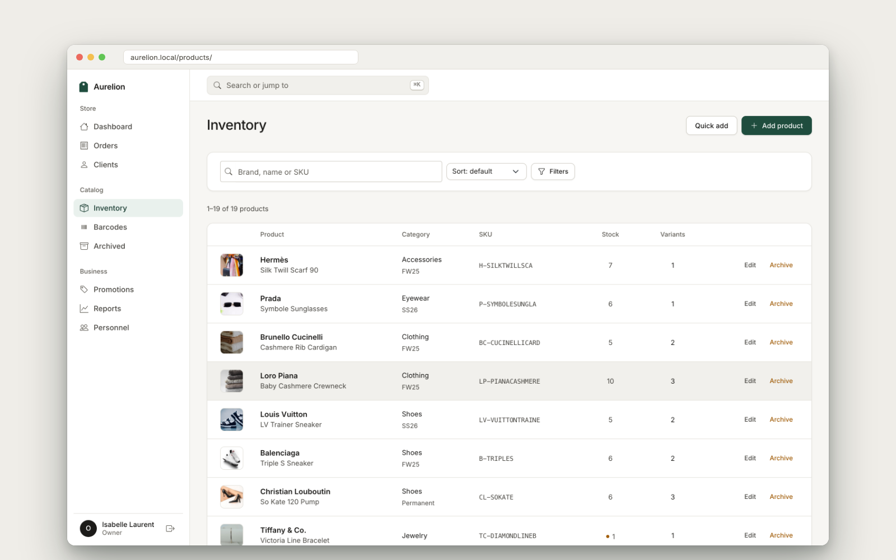

### Product detail

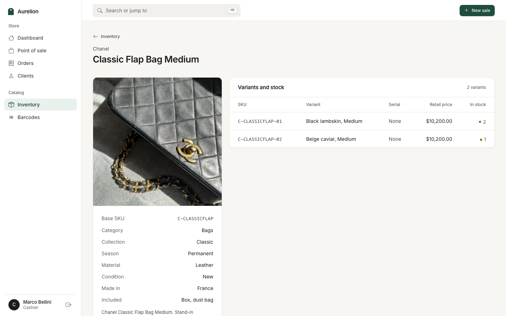

### Point of sale

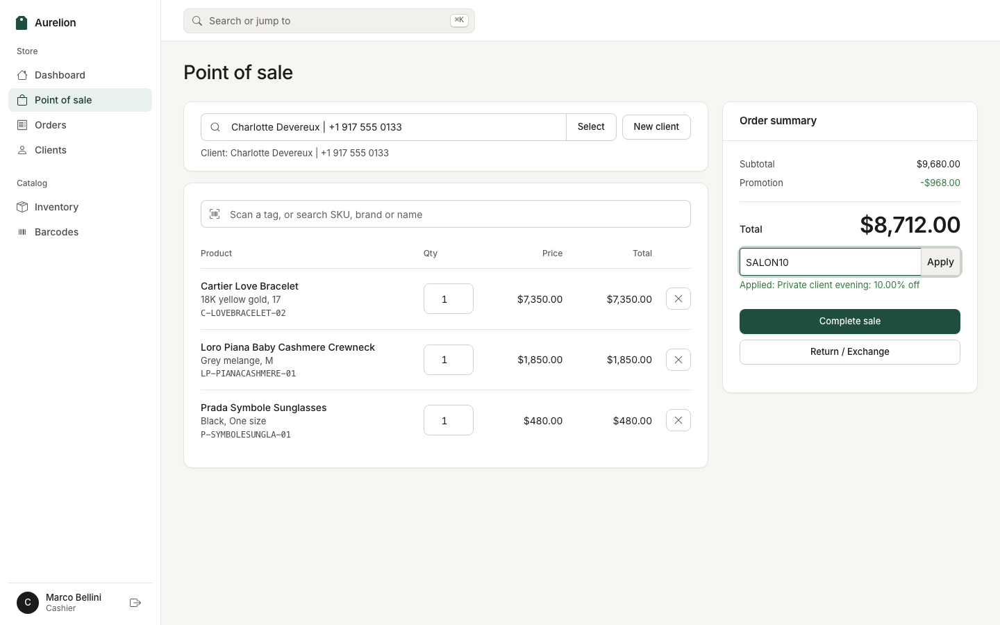

### Orders and returns

<table>
  <tr>
    <td width="50%"></td>
    <td width="50%">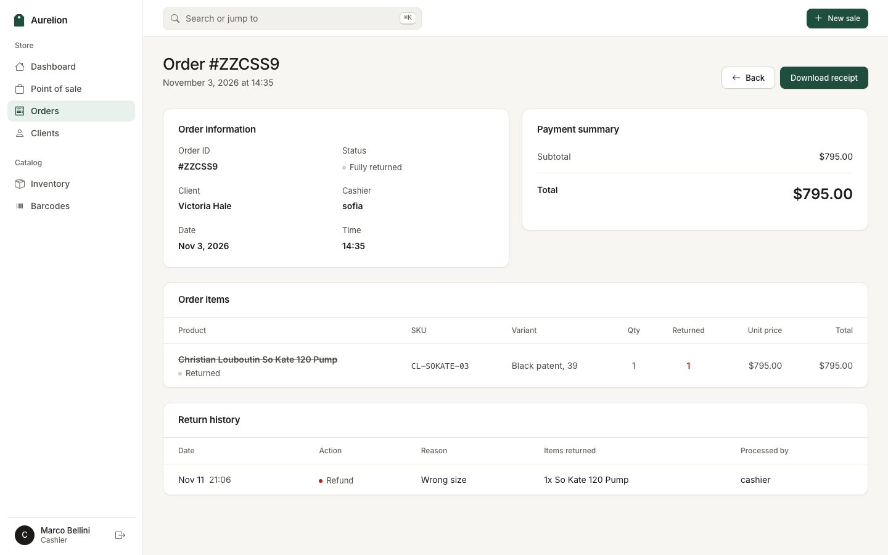</td>
  </tr>
</table>

### Clients, promotions and reports

<table>
  <tr>
    <td width="50%">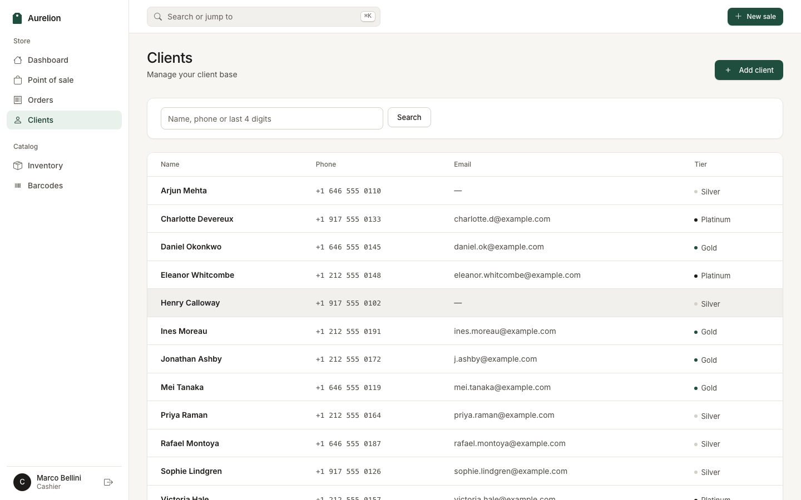</td>
    <td width="50%">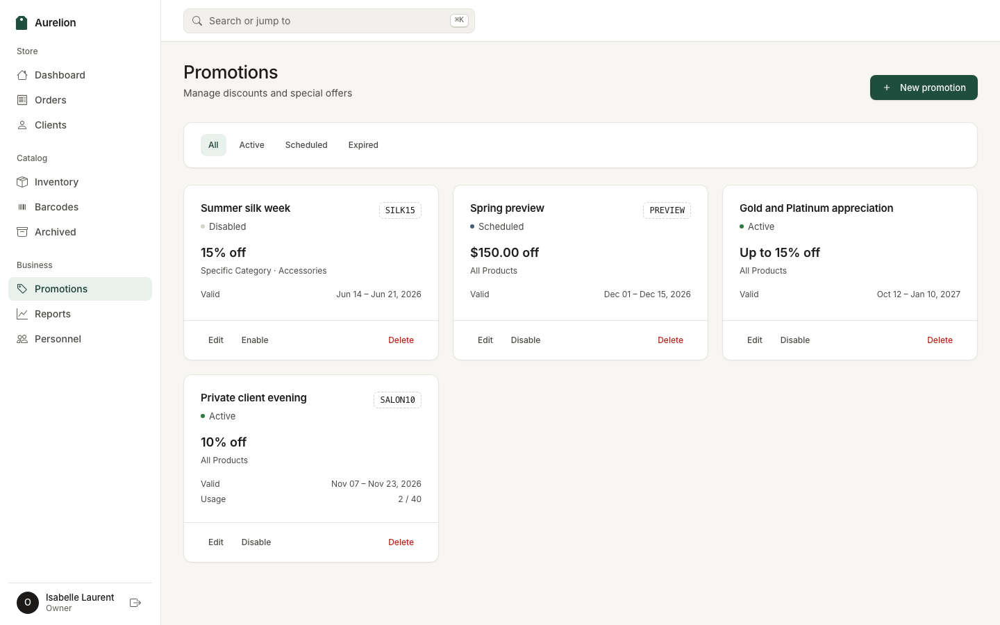</td>
  </tr>
  <tr>
    <td colspan="2">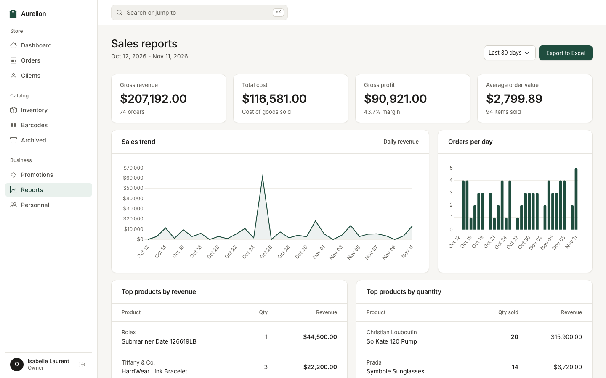</td>
  </tr>
</table>

### Product registration, labels and receipts

<table>
  <tr>
    <td width="50%">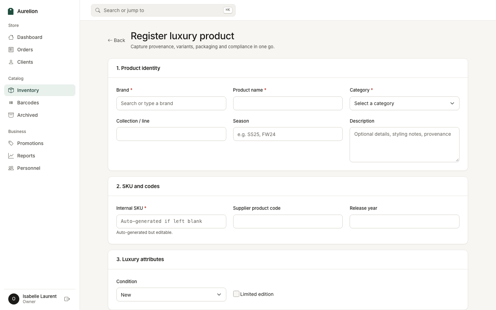</td>
    <td width="50%">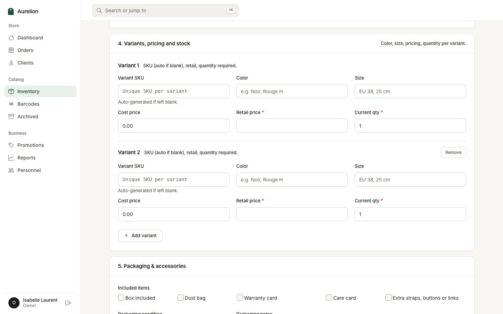</td>
  </tr>
  <tr>
    <td width="66%">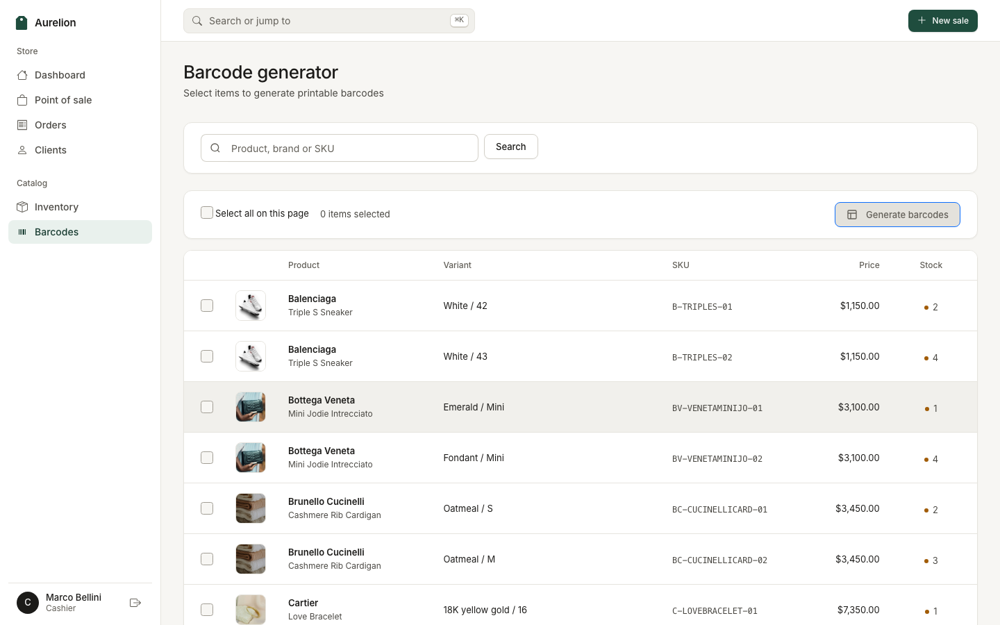</td>
    <td width="34%">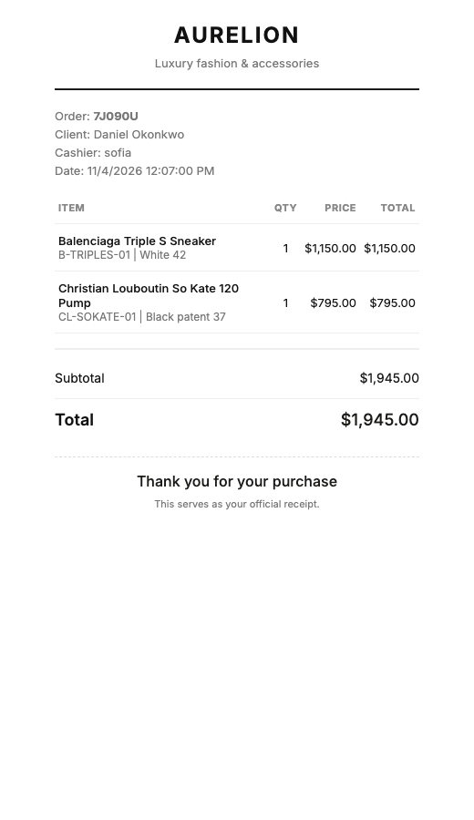</td>
  </tr>
</table>

### Sign in

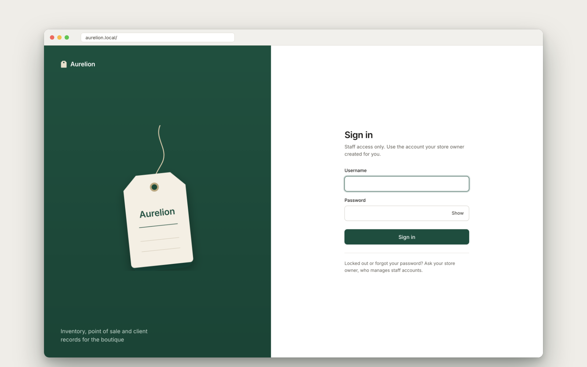

## Tech stack

| Layer | Technology |
| --- | --- |
| Language | Python 3.10+ |
| Web framework | Django 5.2 (class-based views, custom user model, formsets) |
| API | Django REST Framework (read-only, session authentication) |
| Database | SQLite for local use, PostgreSQL in production |
| Frontend | Django templates, Bootstrap 5.3 grid and components, vanilla JavaScript, Inter |
| Charts | Chart.js 4 |
| Images | Pillow (upload validation and normalisation) |
| Barcodes and PDF | python-barcode, ReportLab |
| Spreadsheet export | openpyxl |
| Camera scanning | html5-qrcode |
| Static files | WhiteNoise |
| App server | Gunicorn |

## Architecture

```text
┌─────────────────────────────────────────────────────────┐
│  Browser                                                │
│  Django templates, Bootstrap, JavaScript                │
│  Camera barcode scanner (html5-qrcode)                  │
└────────────────────────────┬────────────────────────────┘
                             │  HTTPS + CSRF
┌────────────────────────────▼────────────────────────────┐
│  Django application                                     │
│                                                         │
│  Authentication and role-based permissions              │
│                                                         │
│  ┌───────────────────────────┐  ┌─────────────────────┐ │
│  │ Views                     │  │ REST API (read-only)│ │
│  │ Inventory, POS, returns   │  │ Products, clients,  │ │
│  │ Clients, promotions       │  │ orders              │ │
│  │ Reports, personnel        │  │                     │ │
│  └───────────────────────────┘  └─────────────────────┘ │
│                                                         │
│  Services: Pillow, ReportLab, python-barcode, openpyxl  │
└────────────────────────────┬────────────────────────────┘
                             │
         ┌───────────────────┴───────────────────┐
         ▼                                       ▼
┌─────────────────────┐               ┌─────────────────────┐
│ SQLite / PostgreSQL │               │ Media storage       │
│ application data    │               │ product images      │
└─────────────────────┘               └─────────────────────┘
```

**Domain model:** `Product` → `ProductVariant` → `StockLevel`, `Barcode`, `StockMovement`;
`Order` → `OrderItem` → `Return`, `ReturnItem`; `Client` → `LoyaltyAccount`; `Promotion` → `PromotionUsage`.

## Getting started

### Prerequisites

- Python 3.10 or newer

### 1. Install

```bash
git clone https://github.com/samandar-ev/aurelion-inventory-management.git
cd aurelion-inventory-management

python3 -m venv .venv
source .venv/bin/activate          # Windows: .venv\Scripts\activate
pip install -r requirements.txt
```

### 2. Create the database and load the demo boutique

```bash
python manage.py migrate
python manage.py seed_demo --reset
```

`seed_demo` creates five staff accounts, a photographed catalogue of 19 pieces (30 variants), 12 clients
across all loyalty tiers, promotions, seven weeks of sales, today's sales in progress, and a partial return
and an exchange. Pass `--password` to choose your own password.

| Role | Username | Name |
| --- | --- | --- |
| Owner | `owner` | Isabelle Laurent |
| Cashier | `cashier` | Marco Bellini |
| Cashier | `sofia` | Sofia Reyes |
| Sales associate | `associate` | Amara Okafor |
| Sales associate | `theo` | Theo Lindqvist |

Every account uses the password `aurelion-demo`. To create one account per role without any data, run
`python manage.py create_demo_users` instead.

> [!WARNING]
> The demo accounts and password are for local use only. Never load them into a public deployment.

### 3. Run

```bash
python manage.py runserver
```

Open http://127.0.0.1:8000 and sign in. A short walkthrough:

1. As `cashier`, open **Point of sale**, search for "love bracelet", add it, attach a client and apply `SALON10`.
2. Complete the sale, then start a return from **Return / Exchange** with the order code.
3. As `associate`, use **Stock lookup** on a phone-sized window and search for "rolex".
4. As `owner`, review **Reports** and export the period to Excel.

## Configuration

| Variable | Default | Purpose |
| --- | --- | --- |
| `DJANGO_DEBUG` | `True` | Set to `False` in production |
| `DJANGO_SECRET_KEY` | development key | Required when `DJANGO_DEBUG` is `False`; the app refuses to start without it |
| `DJANGO_ALLOWED_HOSTS` | `*` locally, `localhost` in production | Comma-separated host names |
| `DJANGO_CSRF_TRUSTED_ORIGINS` | empty | Comma-separated origins, for example `https://shop.example.com` |
| `DJANGO_SECURE_PROXY_SSL_HEADER` | `False` | Set to `True` behind a proxy that sends `X-Forwarded-Proto` |
| `DJANGO_HSTS_SECONDS` | `31536000` | HSTS max-age in production |
| `DJANGO_TIME_ZONE` | system time zone | Override the detected time zone |

With `DJANGO_DEBUG=False` the session and CSRF cookies are marked secure and HSTS is enabled. Redirecting
HTTP to HTTPS is left to the load balancer or reverse proxy.

## Roles and permissions

Roles are hierarchical: each role includes everything the role below it can do. Every rule is enforced on
the server.

| Capability | Sales associate | Cashier | Owner |
| --- | :---: | :---: | :---: |
| Browse inventory, product details and stock lookup | Yes | Yes | Yes |
| View clients | Yes | Yes | Yes |
| Point of sale, returns and exchanges | | Yes | Yes |
| Create and edit products and clients | | Yes | Yes |
| Generate barcode labels | | Yes | Yes |
| View orders and the sales dashboard | | Yes | Yes |
| Archive products | | Yes | Yes |
| Delete or restore products | | | Yes |
| Promotions | | | Yes |
| Reports and Excel export | | | Yes |
| Staff accounts | | | Yes |

## REST API

Read-only JSON endpoints with session authentication, browsable at `/api/`. All writes go through the web
application, which enforces pricing, stock and role rules.

| Endpoint | Methods | Access |
| --- | --- | --- |
| `/api/products/` | `GET` | Sales associate and above |
| `/api/clients/` | `GET` | Sales associate and above |
| `/api/orders/` | `GET` | Cashier and above |
| `/health/` | `GET` | Public database health check |

## Security

- Sale, discount and exchange prices are taken from the catalogue on the server, never from the browser
- Stock rows are locked during checkout, and the return window is checked again when a return is processed
- Role checks on every view and API endpoint, with CSRF protection on all state-changing requests
- Staff-entered text is escaped before it reaches the page or a receipt; order data is passed with `json_script`
- Uploads must be real images under 10 MB; spreadsheet exports escape cells that could run as formulas
- Staff passwords go through Django's password validators
- Production refuses to start without a secret key and uses secure cookies, HSTS and strict security headers

## Testing

```bash
python manage.py test core
```

The suite covers role boundaries, server-side pricing, the return window, stored XSS, upload validation,
spreadsheet escaping, password rules, the associate lookup, and a smoke test that renders every page for every
role.

## Project structure

```text
aurelion-inventory-management/
├── aurelion/                    Project settings, URLs, WSGI and ASGI
├── core/
│   ├── demo/products/           Demo product photos used by seed_demo
│   ├── management/commands/     seed_demo, create_demo_users
│   ├── migrations/
│   ├── static/core/css/         Application stylesheet
│   ├── templates/core/          Server-rendered pages
│   ├── templatetags/            Number and currency filters
│   ├── api.py, api_urls.py      Read-only REST API
│   ├── forms.py                 Product forms and variant formsets
│   ├── models.py                Domain model
│   ├── permissions.py           Role mixins and API permissions
│   ├── serializers.py
│   ├── tests.py
│   └── views.py                 Inventory, POS, returns, reports and staff
├── docs/
│   ├── mockups/                 README device mockups
│   └── screenshots/             README screenshots
├── manage.py
└── requirements.txt
```

## License

Copyright © 2025–2026 Samandar Erkinov. All rights reserved.

This is proprietary software published for portfolio viewing only. You may not copy, modify, distribute or
use any part of this code without prior written permission. See [`LICENSE`](LICENSE) for the full terms.

**Disclaimer.** Aurelion is a fictional retail platform built for portfolio demonstration. Brand names appear
only to demonstrate catalogue and inventory features; Aurelion is not affiliated with or endorsed by those
brands. Demo product photos are stand-ins from Pexels used under the Pexels License (sources in
[`core/demo/products/CREDITS.md`](core/demo/products/CREDITS.md)).
